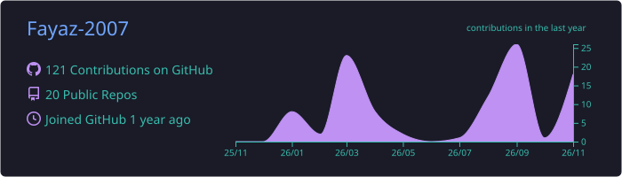
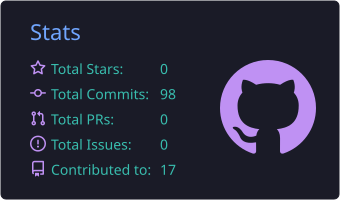
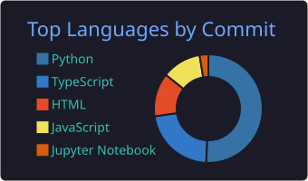
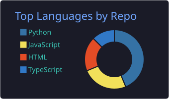
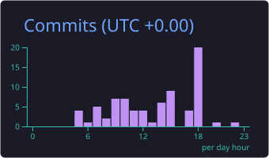

## 🧑‍💻 About Me

- 🎓 B.E. Computer Science Engineering student at **SVCE, Chennai** (2024–2028)
- 📣 **Marketing Lead** at **KNOW-I**, an AI/intelligence club in the CSE department
- 💼 Freelance **web development & design** work
- 🤖 Currently building **AI agents** and full-stack products — from local-first RAG workbenches to hackathon-ready ML tools

## 🛠️ Tech Stack

**Languages**

**Frontend**

**Backend**

**Tools**

## 🚀 Featured Projects

<table>
<tr>
<td width="50%">

### [Sovereign AI Workbench](https://github.com/Fayaz-2007/workbench)
Self-hosted, air-gapped agentic AI workbench for confidential industrial work — local inference, RAG and document generation, zero external AI calls.

  

</td>
<td width="50%">

### [SupplySense](https://github.com/Fayaz-2007/supply-chain)
Dataset-agnostic AutoML studio — upload any tabular dataset and get EDA, model comparison, predictions and business reports.

  

</td>
</tr>
<tr>
<td width="50%">

### [I-Cube Legal Chatbot](https://github.com/Fayaz-2007/legal-chatbot)
RAG-powered legal chatbot answering Indian cybercrime law questions with source citations.

  

</td>
<td width="50%">

### [AgriVarsha — Monsoon Advisory](https://github.com/Fayaz-2007/monsoon-advisory)
SIH 2026 project: hyperlocal monsoon onset/break prediction and crop advisories for Tamil Nadu farmers.

  

</td>
</tr>
<tr>
<td width="50%">

### Local Shop Delivery
Hyperlocal grocery delivery marketplace for Ambattur, Chennai — customer, shop admin and delivery partner apps.

  

</td>
<td width="50%">

### [RPi IoT Monitoring](https://github.com/Fayaz-2007/raspberry-pi-iot-environment-monitoring)
Raspberry Pi + Node-RED environment monitor — temperature, motion, gas and automatic LED control.

 

</td>
</tr>
</table>

## 📊 GitHub Stats

 

 

## 🔥 Streak & Activity

## 🤝 Connect

